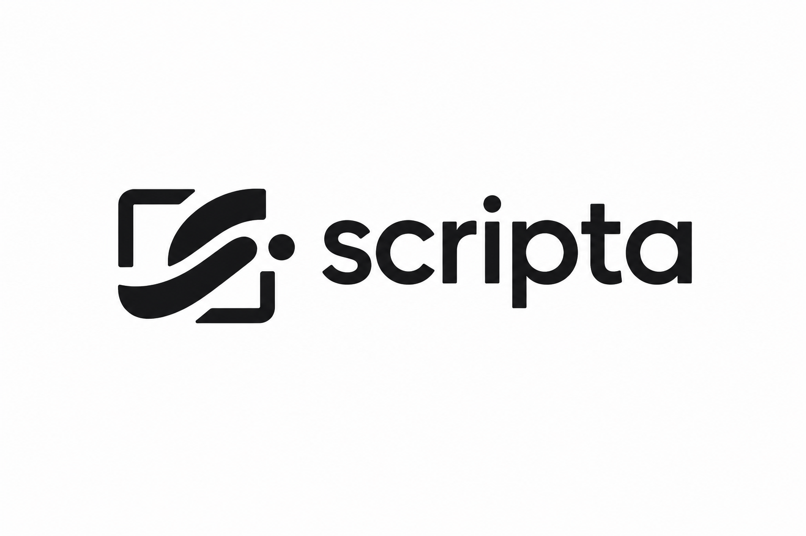

<p align="center">
  
</p>

# Scripta

A lightweight browser-based digital whiteboard where your smartphone acts as a wireless drawing tablet in real time.

## Features

- **Wireless phone tablet** — scan a QR code and draw on your laptop from your phone.
- **Smooth handwriting** — adjustable phone input smoothing and cursor glide in Settings.
- **Infinite canvas** — pan, zoom, and auto-save locally.
- **Shapes & connectors** — rectangles, ellipses, diamonds, lines, and magnetic arrows.
- **Guided onboarding** — welcome page, replayable tutorial, and a Help & Shortcuts panel.

## Milestone 0: Technical Spikes

Before building the full monorepo, validate the two riskiest UX/browser assumptions on your actual phone:

1. **`spikes/01-touch-pad.html`** — Tests mobile Safari/Chrome touch & stylus capture (`touch-action: none`, `setPointerCapture`, `getCoalescedEvents()`, palm/multi-touch filtering, and Quadratic Bézier smoothing).
2. **`spikes/02-aspect-mapping.html`** — Tests isotropic (aspect-ratio-locked) coordinate mapping between a phone pad and a desktop canvas so circles never squash into ovals.

### Quick Run (Local LAN)

Serve the `spikes/` folder on all network interfaces (`0.0.0.0`):

```powershell
npx --yes serve spikes -l 8080
```

Then open `http://<YOUR-LAPTOP-LAN-IP>:8080/01-touch-pad.html` on your phone (on the same Wi-Fi).
